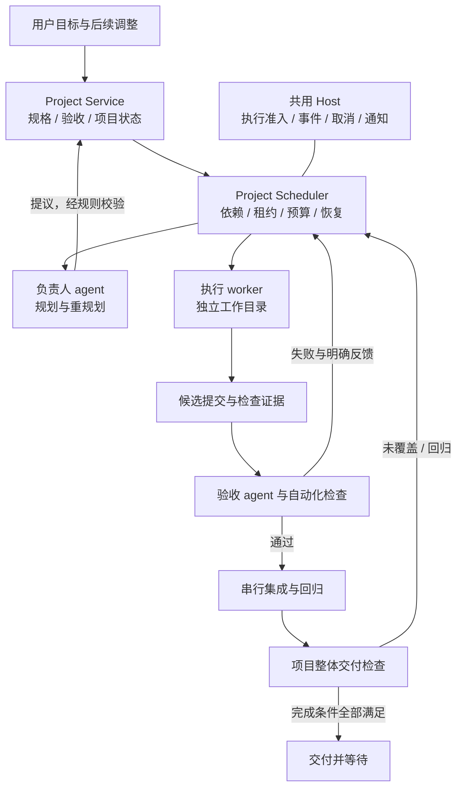

# Loom 长期项目执行：架构研究与建议方案

研究日期：2026-10-24。状态：可评审的设计方案，尚未实现重型项目执行。本文区分已读源码、官方说明和 Loom 的设计建议；不把示例、营销描述或数小时实验当成一周无人值守的验证。

2026-10-25 补充：[首版实施规格](long-running-project-spec-2026-10-25.md)将本研究收敛为具体协议；[SQL 草案](long-running-project-schema-v1.sql)仅用于设计验证。后续规格选择独立 projects.sqlite3 与跨存储幂等核对，取代本文早期偏向同库的候选；暂停与执行状态也改为正交表达。发生差异时以实施规格为准。

## 1. 决策摘要

在 Loom 现有 Agent Runtime 上增加项目级控制层，暂称 Project Runner。保留现有模型/工具循环、权限、会话日志、计划图、证据系统和上下文管理。首版不整体引入 OpenHands、LangGraph 或 Temporal 替换 runtime。

Project Runner 是确定性程序，持有项目状态、任务调度、资源准入、预算与完成条件。负责人 agent 提出计划和调整，执行 agent 完成任务，验收 agent 检查具体版本；它们都不能凭一句「完成」直接关闭整个项目。

先完成串行、可恢复的端到端闭环，再开放受限并行。建议初始最多两个实现 worker；负责人和验收者按事件调用，不各自永久空转。该并发数是需要实验校准的初值，不是性能结论。

目标是「一次授权目标，多次执行会话，持续形成可验收成果」。一周是允许持续推进的时间尺度，不是交付承诺，也不意味着必须耗满一周。

## 2. 已调查项目与采用判断

| 项目/资料 | 已核实的机制 | 对 Loom 的选择 |
| --- | --- | --- |
| Anthropic autonomous-coding quickstart | 初始化与后续编码分开；每轮新上下文；文件和 Git 保存进度；外层循环接续 | 借鉴交班与小步推进；该仓库明确是 demo，不直接当生产调度器 |
| Anthropic 长期应用 harness 实验 | planner、generator、evaluator；结构化交班；功能与体验评估；模型变化后减少不必要流程 | 借鉴验收与按难度启用角色；不固定套用其 sprint 数量或成本 |
| OpenHands software-agent-sdk | ConversationState 持久化配置与运行状态；事件日志；迭代上限；StuckDetector 检测重复动作/错误等 | 重点参考执行 episode、事件恢复、卡死检测；现有 Loom worker 已有工具能力，无需整体替换 |
| LangGraph / Deep Agents | checkpointer 与跨线程 store 分离；子 agent 上下文隔离；文件后端与上下文卸载；源码默认限制 fork 后递归委派 | 借鉴状态/记忆分离和有边界委派；暂不增加第二套图运行时 |
| Temporal | 事件历史恢复 workflow；activity 重试；官方要求考虑幂等，执行成功但未报告仍可能重试 | 借鉴持久调度语义；多机版候选，首版本地 Windows 不强制运维 Temporal 服务 |
| OpenClaw / Hermes | 常驻入口、自动任务与技能/记忆；OpenClaw 当前已统一 heartbeat 到 automations | 主要供轻量常驻窗口研究；这些机制本身不等于开发项目完成协议 |

这些开源项目分别解决 agent 执行、状态或调度的一部分。尚未在本研究中获得「任意大项目，一句话，一周稳定交付」的可重复证据。

### 研究边界

实际阅读了 OpenHands 的 state.py 与 stuck_detector.py、Deep Agents 的 subagents.py、Anthropic demo 的 README 和 agent.py，以及各官方设计文档。没有安装并实跑这些外部框架，也没有完成许可证/依赖引入审查。本方案以借鉴模式为主；若后续复制实现或加入依赖，必须固定 commit/version 并检查许可证。网页与 main/master 源码可能变化，访问日期如上。

## 3. Loom 现状：可以复用什么

以下为工作区当时源码观察，基准 HEAD 为 86f43ac9；工作区已有其他窗口的未提交改动，因此具体行为还需在实施时重新核对。

| 现有文件 | 观察 | 在重型模式中的用途与缺口 |
| --- | --- | --- |
| app/agent_runtime/durable_state.py | SQLite/WAL thread_goals、thread_queue，事务领取 | 复用会话目标与入队；项目仍需独立身份、跨会话任务和 attempt |
| app/agent_runtime/durable_runtime.py | continue_goal 有界续跑；recover_interrupted 将丢失执行栈视为中断，旧审批/工具能力失效 | 保留中断语义；新增项目协调器决定何时恢复，不能一律重放工具 |
| app/agent_runtime/plan_state.py、plan_tools.py | DAG、acceptance、revision、operation_id、claim_id、review/rework、下游失效 | 已有重要底座；每个计划只有一个 current claim，不能直接当多 worker 调度表 |
| app/agent_runtime/agent_graph.py、agent_control.py | 持久父子关系、子会话与队列；Future 属于进程；spawn 使用父 workspace | 复用 worker 会话身份；增加 attempt 的独立工作区绑定与恢复，而非共享目录并行改代码 |
| app/agent_runtime/verification.py | 检查记录、源码快照与过期判断，区分来源 | 扩展为绑定候选版本、验收定义、环境的项目验收证据 |
| app/agent_runtime/development_verification.py | 观察源码变更，区分视觉/功能验证，限制重复补验 | 保留每轮开发检查；项目结项仍需全量验收覆盖，不能仅看最近一轮 |
| app/agent_runtime/journal.py | 事件/会话 redo journal，session 执行锁 | 继续作为会话执行边界；新增项目调度事务与 fencing，不能长时间持 DB 事务等待模型 |
| app/project_git_workflow.py | 已有创建/移除 worktree 的项目操作 | 提取/复用受控 Git 能力；自动 worker 生命周期不应强制注册成用户项目或切换 UI |
| host-runtime/README.md | 文档描述独立 Host runtime、staging、自检、原子激活与失败回滚 | 自升级应接现有发布路径；本文未验证其全部实现，不能另造不兼容升级器 |

重要区别：现有计划图是会话内工作协议，项目调度图是跨会话的执行权与依赖权威。首版让每个项目 task 映射一个 worker 会话的计划；项目 task 只记录依赖、版本、attempt 和验收结果，不复制 worker 内部每一个步骤。现有 chat plan 的行为保持兼容。

不让 thread goal、chat plan 和 project task 三处同时决定项目状态。项目级状态是权威；会话 goal 只是 episode 的执行意图，聊天计划是局部进度投影。

## 4. 架构与责任

- Project Service：版本化规格、验收定义、项目授权与决策记录。保存推断出的假设；常规可逆选择直接推进，只有真正阻断的歧义才请求用户决策。
- Scheduler：用代码计算 ready task、领取 attempt、控制并发、检查预算与取消、处理超时和恢复。等待工具/worker 完成靠事件，不靠模型反复询问。
- 负责人 agent：先形成最小可运行纵向切片与接口约定，再按里程碑逐步细化 DAG；失败后提出可解释的重规划。不能删掉失败验收来凑完成率。
- Worker：领取一个 task contract，在固定 base 的独立目录工作，运行局部验证，提交候选结果。提交结果只是 ready for review。
- Verifier：新会话读取 contract、候选代码与原始证据，能复现实用流程；不只读取 worker 的成功摘要。不默认允许修改验收或直接修产品代码，修改建议返回 worker。
- Integrator：单写者处理 candidate 合并、冲突与集成回归。角色可由负责人承担，但并发写入权由程序限制。

首版限制嵌套 spawn：项目调度器是 worker 配额唯一分配者。探索性子任务如需委派必须计入同一预算与并发槽位，不能形成无人掌握的递归 agent 树。

## 5. 生命周期与数据模型

项目状态建议：draft → planning → running → verifying → completed。额外状态 paused、waiting_external、needs_input、budget_limited、failed、cancelled；恢复时进入 recovering，核对后再回到运行。仅明确用户暂停才写 paused；没有 ready task 不等于完成。

任务状态建议：pending → ready → leased → running → candidate → reviewing → integrating → done。失败进入 retry_wait、rework、blocked 或 failed。完成依赖必须要求上游 done 且证据版本仍有效。

建议新增项目存储模块与有版本迁移的表；具体同库/独库选择在 Host 接口确定后实施。首选现有 runtime state.db 的独立表与一次事务，避免跨数据库宣称原子提交。

| 记录 | 必需字段 |
| --- | --- |
| project | id、objective、spec_revision、status、control_revision、workspace/repository、budget_policy、delivery_policy |
| requirement | id、spec_revision、来源、明确假设、acceptance_definition_hash、验证方法、必需/可选 |
| task / dependency | id、project_id、task_revision、contract、依赖版本、输入 base、输出、acceptance_ids、status |
| attempt | id、task_id、worker_session_id、base_commit、candidate_commit、worktree_id、epoch、lease、状态、失败分类 |
| artifact / check | 内容 hash、候选 commit/tree、验收定义 hash、环境/依赖 hash、命令/断言、退出码、证据引用、评估来源 |
| decision / event | 单调序号、operation_id、原因、actor、关联项目/task/attempt、输入输出版本 |
| outbox / inbox | delivery_id、幂等键、待执行/已确认、重试时间、关联 session/turn，支持双向重放去重 |
| reservation / usage | project/task/attempt、model request、预留 token/金额、实际用量、未知用量、结算状态 |

SQLite 事务只做短时状态变更；网络、模型、Git 和 shell 在事务外。单个 scheduler 负责项目状态写入，worker 以带版本的结果事件回报，避免多个 SQLite 写者互相长时间等待。

claim 用事务原子检查依赖、control_revision、预算和资源，再生成 attempt 与递增 epoch。只有匹配当前 epoch 的结果能推进 task。过期 worker 的结果保留供审计，但不能发布或合并。

项目 DB 与会话日志不是天然同一个事务：通过 outbox 持久化「准备启动 episode」，消费者按 operation_id 唯一关联 session/turn；结果先持久化到会话日志，再投递项目 inbox。重启后双向核对，避免启动成功但 task 没记录或结果已存在却又跑一轮。

## 6. 任务拆分与协作规则

规划应先得到可用产品骨架，再逐步扩展；不要先生成数百个微任务。每项任务明确输入、输出、验收、依赖、允许修改范围、资源、预算和重试策略。拆分粒度用真实完成率、重读成本和冲突率校准。

接口/数据模型先形成版本化约定；公共类型、schema、依赖锁文件与全局配置任务串行。独立模块才并行。测试端口、数据库、临时目录和浏览器 profile 按 attempt 隔离；worktree 本身不隔离这些外部资源，也不是 OS sandbox。

首版使用「一个负责人按需运行 + 最多两个实现 worker + 按需独立验收」。复杂度较低的步骤用自动化检查即可；高风险接口、视觉交互、里程碑和最终交付使用独立验收。是否每项都启用 evaluator 应通过对照实验决定。

worker 不把全部聊天历史复制给其他 worker；交接包包含规格版本、task contract、base commit、当前差异、已验证项、失败签名、未决问题、运行命令和证据路径。原始日志可按需检索，不把一周日志每轮全部注入模型。

## 7. 工作区、集成与交付

每个实现 attempt 以已知集成提交建立独立 worktree 和 codex/ 分支。模型工具的 cwd/workspace/sandbox 必须绑定实际目录，不只是 prompt 里写路径。共享工作区依然可用于只读研究；有写入任务必须隔离。

任务完成提供 candidate commit；集成者从当前 integration head 构造待合并 tree。若 candidate 的 base 已落后，重新检查冲突与验收，不能直接沿用旧 base 的通过结论。集成后在精确的新提交上跑相关检查，里程碑跑完整关键流程。

工作区有用户未提交内容时先记录 baseline，不自动 stash/reset/clean。需要纳入项目输入的未提交文件使用明确可追踪快照；不能假设新 worktree 自动包含它们。保留失败 attempt 的未提交成果用于恢复，不无条件删目录。

当前仓库要求完成并验证的本任务改动提交 main 并 push origin：项目交付策略需遵守这个规则。内部 worker 的候选提交属于中间产物，由集成者在 main 发布；仅 stage 本项目文件，不能夹带其他窗口改动。远端前进则 fetch、重新集成与验证，禁止 force push。Git push 不代表部署成功，部署目标另有可验证协议。

## 8. 崩溃恢复与外部副作用

恢复顺序：取得 Host/项目执行权 → 检查控制版本与取消状态 → 找到未终结 attempts → 对照会话事件、工作目录与实际进程 → 记录核对结果 → 决定继续、重试或等待。

| 崩溃位置 | 恢复行为 |
| --- | --- |
| task 已领取，episode 尚未启动 | outbox 重新派发同一 operation，不生成重复逻辑 attempt |
| episode 已运行，结果事件已持久化 | 导入现有结果，不重新实现或重复工具操作 |
| 文件已改，尚未提交候选 | 保留目录，核对 diff，启动恢复 episode；不从旧 base 覆盖 |
| 工具可能成功但没有完成记录 | 标记 outcome_unknown，核对外部事实；不假设成功，也不盲重试 |
| 合并/提交/push 已执行但回执丢失 | 查询 tree、commit 和远端 ref 等事实后补记；未知时不重复发布 |
| 旧 worker 在 lease 过期后返回 | epoch 拒绝状态推进；先确认旧进程已停或隔离，再让新 worker 接管 |

租约过期不证明进程已死；fencing 只能阻止经控制层提交的写入，无法撤销已经发出的任意 shell/API。首版对 outcome_unknown 的非幂等外部操作进入核对或人工决策；绝不宣称 exactly-once 外部工具执行。

审批恢复沿用现有安全边界：旧 pending binding/approval 不复用；如果原授权范围仍有效，由新执行重新走当前权限判断。项目恢复不等于权限升级。

Windows 锁屏/注销可能使 GUI 工具不可用；计算机休眠和断电期间不执行。将 headless coding、browser、interactive desktop 的 capability 状态分开；桌面不可用时让其他 ready task 继续，不能盲点屏幕。

## 9. 验收：项目怎样才算完成

规格中的每个必需 requirement 映射到明确验收，不以提交数、测试数量或 agent 自述当产品完成率。至少覆盖安装/启动、核心用户流程、错误路径、数据持久性，以及任务要求的性能、视觉或部署条件。

证据绑定 candidate commit/tree、acceptance definition、依赖与环境；任一相关输入变化则失效或重验。任意 proof.txt 的 hash 只能说明文件存在，不能证明登录、支付或 UI 行为正确。复用现有 evidence 引用校验，同时增加验收语义与执行来源检查。

验收定义版本化。worker 可提出修改测试的理由，但不能自行删除失败项或把失败改成 passed；定义变更进入负责人/验收流程并重新计算覆盖。独立 verifier 也可能误判，必须保留可复跑脚本与原始观察。

项目完成门槛由代码判定：全部必需验收在最终集成版本通过；没有未解决必需任务/缺陷；构建与运行可复现；交付产物位置明确；用户要求的提交/push/部署均有事实证据；没有未知结果的必需操作。缺凭证只能说明 blocked/未覆盖，不能把 mock 结果当真实集成通过。

## 10. 卡住、重试、预算与控制

失败分类至少包括 transient_provider、rate_limited、environment、implementation、contract、verification、unknown_side_effect。网络失败指数退避；实现失败按证据修复；规格矛盾触发重规划；外部副作用未知先核对。

检测重复 action/error、相同失败签名、没有新证据的复述，以及长时间无验收推进。不能只按代码 diff 判断进展，调研和测试也可能有价值。达到阈值后切换策略、缩小任务或引入诊断者；没有新信息时停止该任务并继续其他 ready task。重试限额跨会话保存，换上下文不能清零。

预算是全项目合计，包括负责人、workers、verifier、失败调用、压缩与记忆处理。模型调用前原子预留预算与并发槽位，完成后结算；预留额度和请求输出上限共同限制并发超额。没有可信价格表时显示 token 和金额估算，不承诺硬美元上限；provider 回执丢失记未知用量，不能按零结算。预留最终集成/验收额度，避免实现耗尽预算后无钱检查。

pause：停止新派发，执行中的工作在安全边界保存；stop/cancel：发出取消并阻止后续接续。用户 steering 增加 control/spec revision，旧结果需要重新判断适用性。暂停和取消记录持久化，服务重启不能自动撤销。预算不足是 budget_limited，不伪称完成或用户暂停。

## 11. 与轻量常驻窗口的分工

轻量窗口已另建聊天「Loom 轻量常驻助理：研究与实现」。其任务文件为 ambient-agent-window-prompt-2026-10-24.md。以下是候选接口，尚非已实现 API：

- HostRuntime：ensure_running、status、shutdown；后台单实例与窗口解耦。
- ExecutionGateway：dispatch_episode(operation_id, session_id, project_id?, attempt_id?, expected_control_revision)、cancel、查询状态。所有来源共享每会话互斥和全局资源准入。
- DurableEventBus：发布事件、游标订阅、ack；消费者幂等，不保证任意外部副作用只执行一次。
- ResourceBroker：model/provider 并发、browser profile、端口、interactive desktop 与 repository integration 租约。项目预算仍由 Project Runner 拥有，gateway 执行准入时验证预留。
- NotificationSink：本地结果与通知去重；只有已配置且已授权的外部路由才发送。

轻量 scheduler 只管理时间/事件触发；Project Scheduler 管理 task/attempt/依赖/结项。所有带 project_id 的恢复事件路由给 Project Scheduler，不能两个 scheduler 同时续跑同一个项目会话。统一事件可支持不同 topic，接口不用把业务全部塞进 thread_queue 的文本字段。

本研究不修改核心运行代码以免与轻量窗口争用；落地前由双方文档核对接口与模块所有权。

## 12. 自主迭代 Loom 自身

先把 Loom 当普通被维护仓库：生成候选、跑测试、实际启动验证、提交与发布。当前正在执行项目的稳定 Host 不从自己的未验证源码目录热加载。

利用现有 Host runtime 升级机制：候选打包 → 隔离自检 → 协议/schema 兼容检查 → 项目 checkpoint 与执行静止 → 切换 → 健康检查 → 恢复项目。外部 bootstrap 保留恢复能力。数据库迁移若不可逆，旧二进制回切不能等同数据回滚，需兼容策略与备份恢复演练。

首版不将自主生产部署或修改自身权限策略作为成功前提；实现顺序先证明能维护其他项目，再维护 Loom 候选版本，最后接已验证的发布/激活链路。

## 13. 实施顺序与放行标准

| 阶段 | 交付内容 | 必须证明 |
| --- | --- | --- |
| A：串行闭环 | ProjectStore、规格/验收版本、单 worker、episode 交班、最终 gate、最小状态 API/UI | 关窗口可继续；新会话接续；执行者说完成不能直接关闭项目 |
| B：恢复与用量 | outbox/inbox、租约/epoch、未知结果核对、全项目预算、pause/cancel | 在关键边界 kill/restart，不重复发布、不丢结果、不恢复旧审批 |
| C：受限并行 | 两个独立工作区、依赖调度、环境隔离、串行集成 | 冲突不覆盖；旧 base 证据失效；总预算不因并发绕过 |
| D：质量与体验 | 独立 verifier、缺陷返工、里程碑验收、进度与阻塞原因 | 完整用户流程可用；故意做假的完成报告被拒绝 |
| E：持续运行 | 真实项目 soak、恢复演练、Loom 候选自迭代 | 先 2 小时，再 24 小时，再 7 天；阶段记录可用性、交付质量与全部成本 |

每阶段可先实现最小测试驱动版本再扩展。不能用 7 天的 accelerated timers 测试冒充真实七天运行；时间模拟只能证明时间逻辑。

## 14. 验证与评估计划

确定性故障注入覆盖：领取后启动前崩溃、启动后回执前崩溃、模型/工具结果落盘前后崩溃、过期 worker 回来、预算并发预留、集成前后崩溃、远端 ref 改变、验收定义改变、用户中途暂停和改目标、长时间网络断开、GUI 不可用、主机重启。

真实基准至少包含：从空仓库实现有持久化的应用；在既有项目增加跨前后端功能；修复带可重复回归的故障；处理需要 schema/公共接口串行的多模块工作。使用相同规格、模型和预算，比较当前 Loom、串行 Project Runner、受限多 agent；记录验收通过率、人工介入、恢复正确率、token/金额、墙钟时间、冲突和返工，而非只数 commits。

本次实际检查：阅读了现有目标/队列、计划图、agent control、证据、Git 与 Host 文档；发现已有测试 test_durable_plan_graph.py、test_runtime_v2_durable_thread.py、test_multi_agent_recovery.py、test_multi_agent_runtime.py。尝试运行这些测试，但本环境 PATH 没有可运行 python，bundled Python 没有 pytest，系统注册 Python 启动失败，因此本次未取得测试通过结果。本文没有修改运行代码；实施前仍必须运行并补齐相关测试。

## 15. 官方来源

1. [Anthropic 长期 agent harness](https://www.anthropic.com/research/effective-harnesses-for-long-running-agents)：跨上下文逐步推进、交班与过早结项问题。
2. [Autonomous coding demo README](https://github.com/anthropics/claude-quickstarts/blob/main/autonomous-coding/README.md) 与 [agent.py](https://github.com/anthropics/claude-quickstarts/blob/main/autonomous-coding/agent.py)：最小多会话执行示例。
3. [长期应用开发 harness](https://www.anthropic.com/research/harness-design-long-running-apps)：规划/生成/评估与简化流程的实验；不是七天可靠性交付数据。
4. [OpenHands SDK](https://github.com/OpenHands/software-agent-sdk)、[ConversationState](https://github.com/OpenHands/software-agent-sdk/blob/main/openhands-sdk/openhands/sdk/conversation/state.py)、[StuckDetector](https://github.com/OpenHands/software-agent-sdk/blob/main/openhands-sdk/openhands/sdk/conversation/stuck_detector.py)。
5. [LangGraph persistence](https://docs.langchain.com/oss/python/langgraph/persistence)、[Deep Agents](https://github.com/langchain-ai/deepagents)、[subagent middleware](https://github.com/langchain-ai/deepagents/blob/master/libs/deepagents/deepagents/middleware/subagents.py)。
6. [Temporal](https://github.com/temporalio/temporal)、[Event History](https://docs.temporal.io/encyclopedia/event-history)、[Activity 幂等性](https://docs.temporal.io/activity-definition#idempotency)、[Python 示例](https://github.com/temporalio/samples-python)。
7. [OpenClaw Automations](https://docs.openclaw.ai/automation/cron-jobs)、[Heartbeat 迁移](https://docs.openclaw.ai/gateway/heartbeat)、[Hermes Agent](https://github.com/NousResearch/hermes-agent)。
